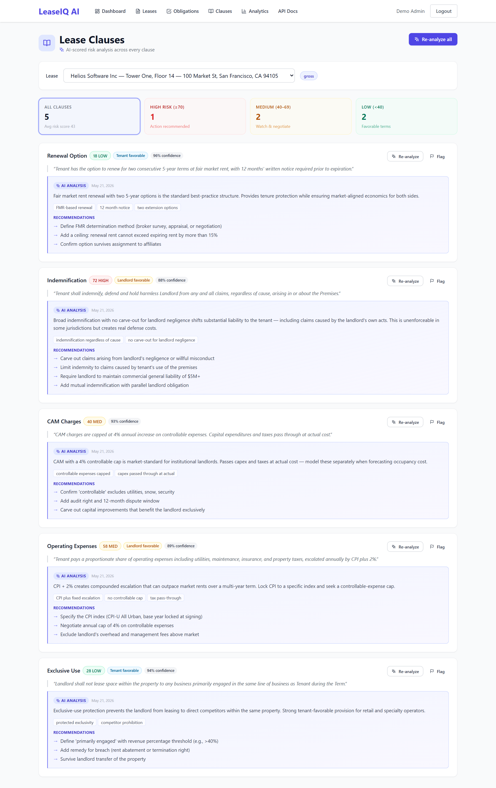
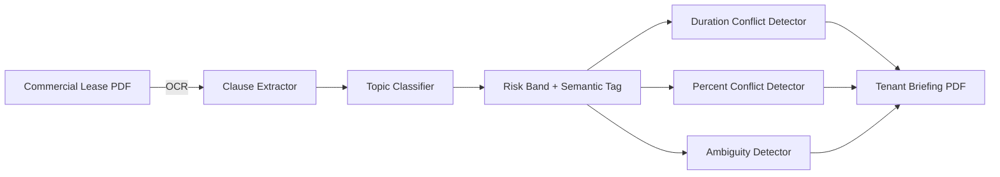
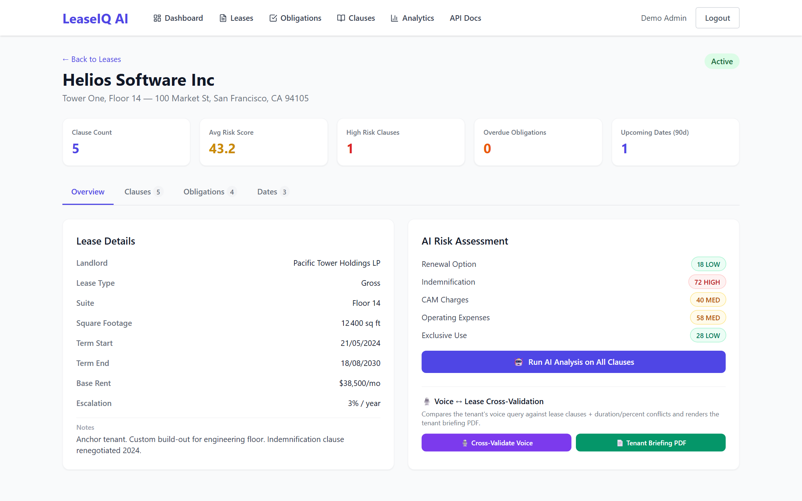
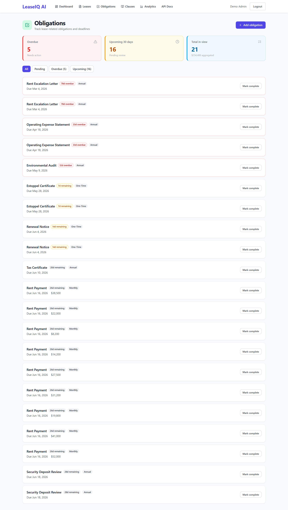
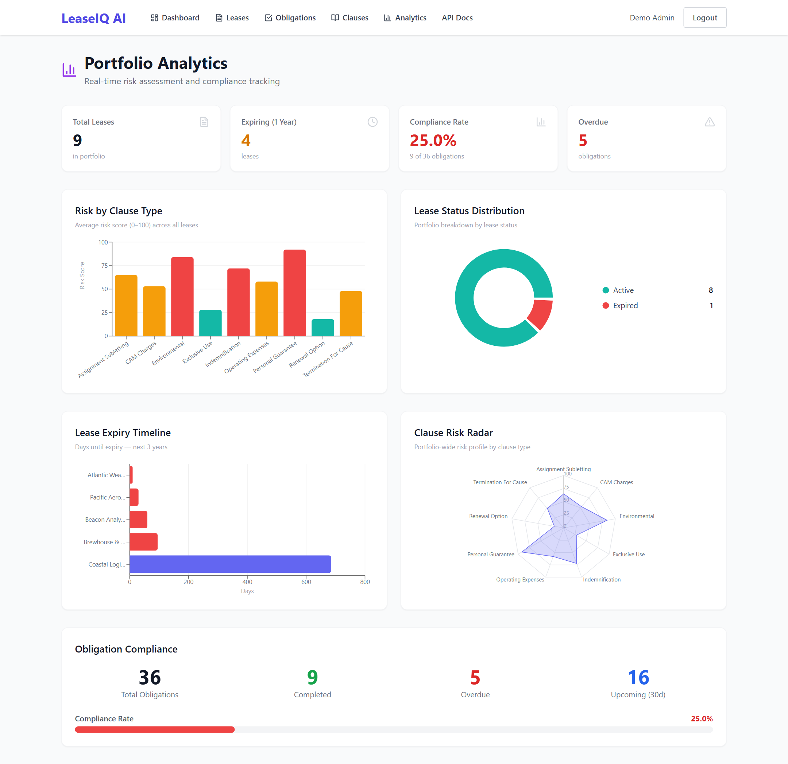
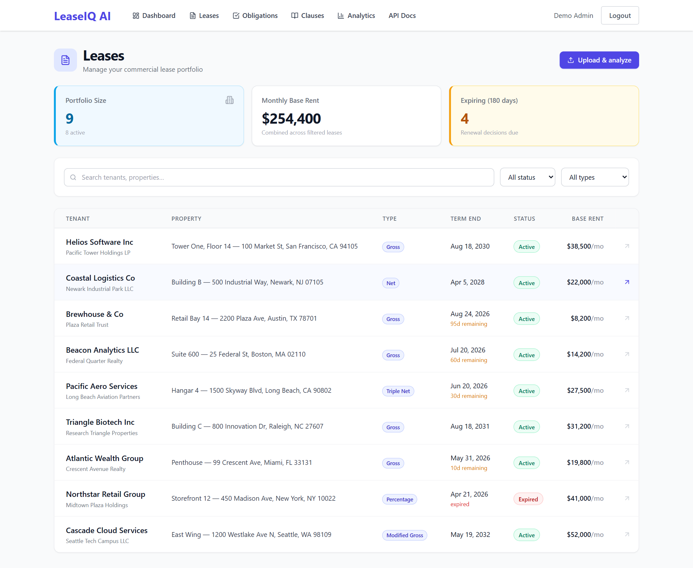
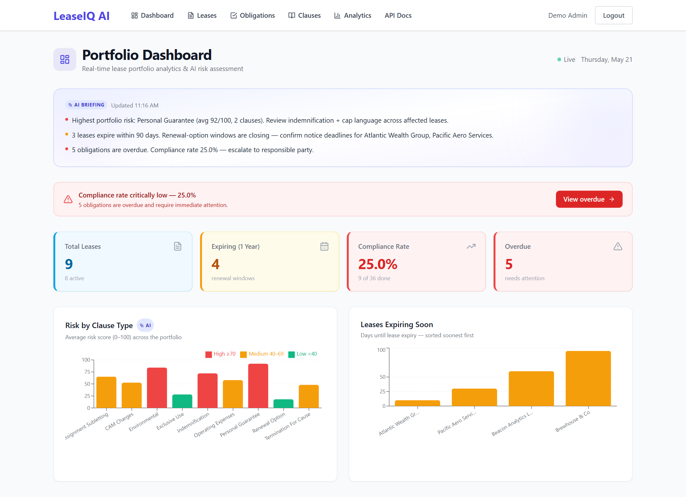

# LeaseIQ AI

> Reads a 60-page commercial lease and surfaces every renewal-option, sublease, CAM-charge, and exclusive-use clause with a risk band in 90 seconds — replacing the broker's binder of marked-up PDFs.

<p align="center">
  
</p>

---

## The problem

Commercial real-estate brokers and corporate real-estate managers signing 5+ year office leases have to read every clause: renewal options, sublease/assignment, CAM (Common Area Maintenance) charges, operating expenses, exclusive use, tenant improvement allowances, force majeure. A senior tenant-rep broker reads each lease in ~4 hours, marks the binder, then writes the executive memo. Across 30 leases per year per broker, that's two weeks just in line-by-line reading.

## What this does

LeaseIQ ingests the lease PDF, extracts every clause via Azure Document Intelligence, classifies each clause into its topic (renewal_option / sublease / cam / operating_expenses / exclusive_use / tenant_improvement / etc.), assigns a risk band (HIGH / MEDIUM / LOW with semantic tags like "MARKET REASONABLE" or "BUSINESS"), runs a duration-window conflict detector, runs a percent-conflict detector, surfaces ambiguity, and outputs a tenant-briefing PDF with per-clause AI analysis.

## Real-world scenario

> A tenant-rep broker uploads the new lease for Helios Software Inc — Tower One, Floor 14 — 100 Market St, San Francisco. LeaseIQ extracts 5 clauses. **Renewal Option — HIGH RISK** (option to renew for one period of fair market rent, 12 months written notice prior to expiration). **Sublease/Assignment — MEDIUM RISK / SUBLEASE BUSINESS** (sublease indemnifies fully; subtenants must comply with the landlord's use clause). **CAM Charges — MEDIUM RISK**. **Operating Expenses — LOW RISK / MARKET REASONABLE**. **Exclusive Use — LOW RISK**. Per-clause AI analysis explains the implication. The broker writes the memo in 20 minutes.

## Why it saves time

| Metric | Manual approach | LeaseIQ | Improvement |
|---|---|---|---|
| Per-lease abstraction | 3–5 hours | **~90 s + ~20 min broker review** | ~10× faster |
| Clause classification | by hand | systematic with risk band per topic | qualitative |
| Tenant briefing | drafted from scratch | AI-drafted with verbatim quotes | qualitative |

## Key features

- **Clause extractor** for renewal_option / sublease / cam / operating_expenses / exclusive_use / TI / force_majeure.
- **Risk band** per clause — HIGH / MEDIUM / LOW with semantic tags (MARKET REASONABLE, SUBLEASE BUSINESS, etc.).
- **Duration-window conflict detector**.
- **Percent-conflict detector** (CAM cap exceeded? OpEx pass-through unbounded?).
- **Ambiguity detection** at the clause level.
- **Tenant briefing PDF** with verbatim clause + AI analysis.
- **Obligations tracker** with critical-date alerts.

## How it works

The non-obvious decision was to **emit semantic tags alongside the risk band**. *Medium risk* on a CAM clause means nothing without context; *"MEDIUM RISK / SUBLEASE BUSINESS"* tells the broker exactly which business posture the lease assumes. Tags drive the broker's memo language and let the system stay neutral on whether *medium* is acceptable for this particular tenant.

## Architecture



## Screenshots

### Lease clauses with risk bands


### Lease detail



### Obligations



### Analytics



### Leases list



### Dashboard



## Stack

- **Backend:** `fastapi`, `sqlalchemy` + PostgreSQL, `azure-ai-documentintelligence` for clause extraction, `openai` SDK for the analyzer, `reportlab` for tenant briefing PDF.
- **Frontend:** `react` + `vite` + `react-router-dom`, `@tanstack/react-query`.
- **Infra:** Docker Compose (api, worker, postgres, redis, frontend).

## Quick start

```bash
git clone https://github.com/wissalbenothmen/leaseiq-ai.git
cd leaseiq-ai
cp .env.example .env   # OPENAI_API_KEY, AZURE_DI_*, JWT_SECRET
docker compose up -d
# API: http://localhost:8022/docs — UI: http://localhost:5022
```

## Limitations

- **US commercial leases.** Industrial and retail leases use different clause grammars and may need additional topic detectors.
- **English leases only.** Bilingual jurisdictions (e.g., Quebec) need French clause detectors.
- **Expiration calendar is list-based today.** A monthly heatmap visualization is on the roadmap.
- **No CRM bidirectional sync.** Leases load via PDF; deeper integration with VTS / CoStar is roadmap.

## Roadmap

- [ ] Industrial + retail lease clause detector packs.
- [ ] Expiration calendar heatmap.
- [ ] Bidirectional sync with VTS / CoStar.
- [ ] French clause detectors.
- [x] Risk band + semantic tag per clause.
- [x] Duration + percent conflict detectors.
- [x] Tenant briefing PDF.

## What I learned

- **Semantic tags alongside risk bands** is what makes the product useful — a band alone doesn't tell the broker which business posture the lease assumes.
- **Clause-by-clause AI analysis** beats a single lease score; the broker's memo lives clause by clause.

## License

Released under the [MIT License](LICENSE).

## Acknowledgements

Built with [FastAPI](https://fastapi.tiangolo.com/), [SQLAlchemy](https://www.sqlalchemy.org/), [React](https://react.dev/), [Azure Document Intelligence](https://learn.microsoft.com/en-us/azure/ai-services/document-intelligence/), and [ReportLab](https://www.reportlab.com/).
